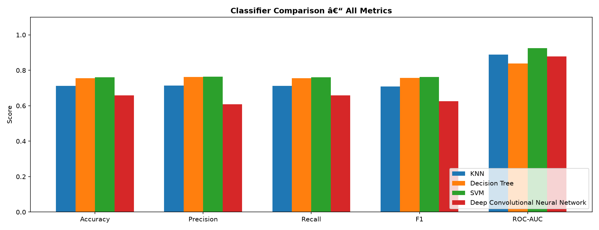
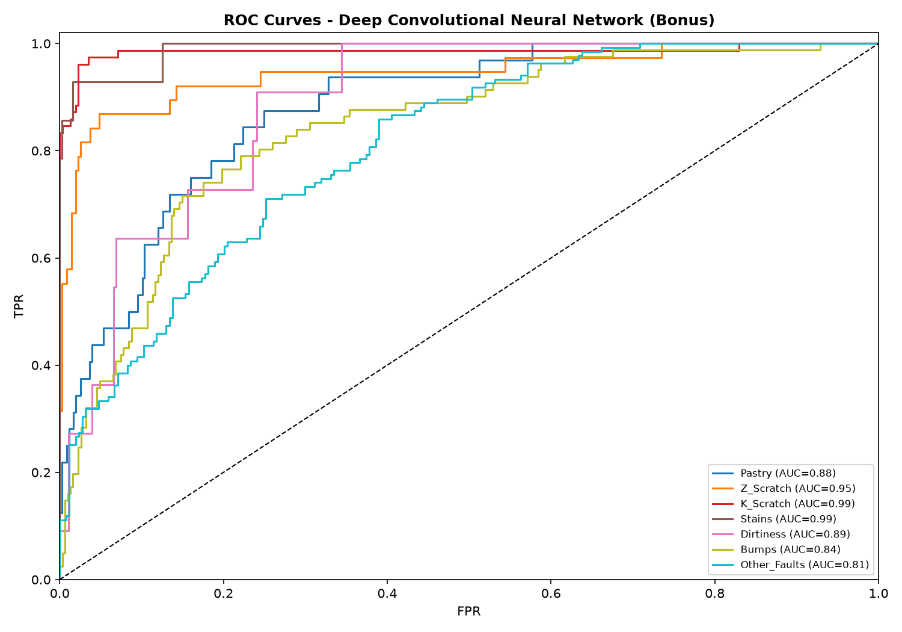
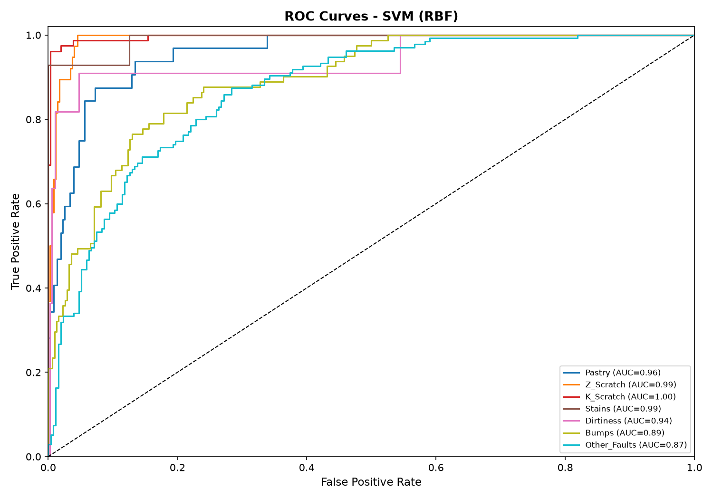
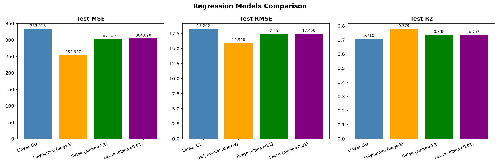
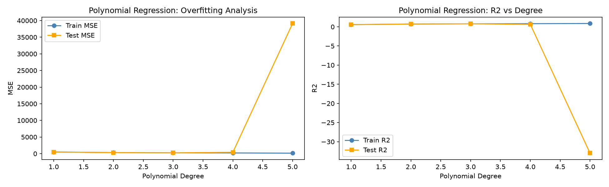
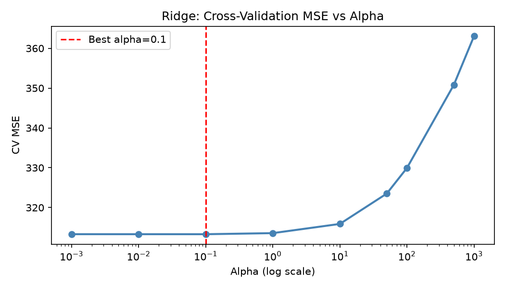
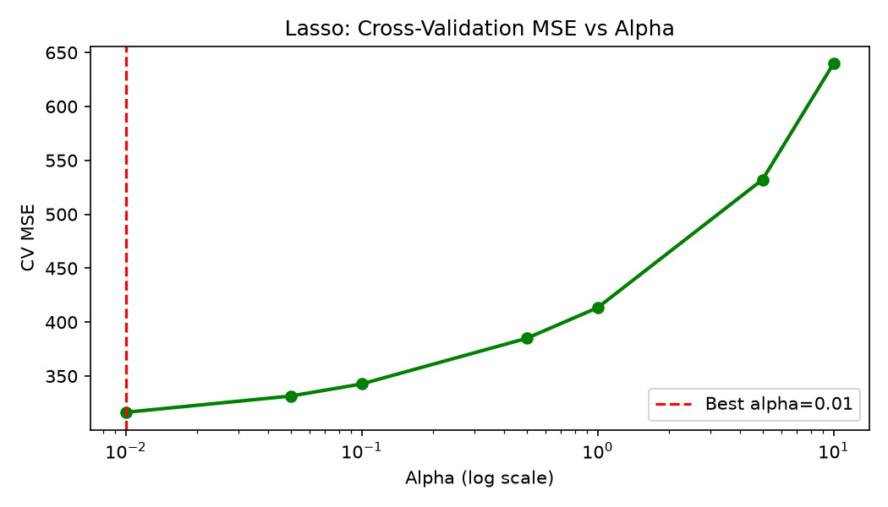
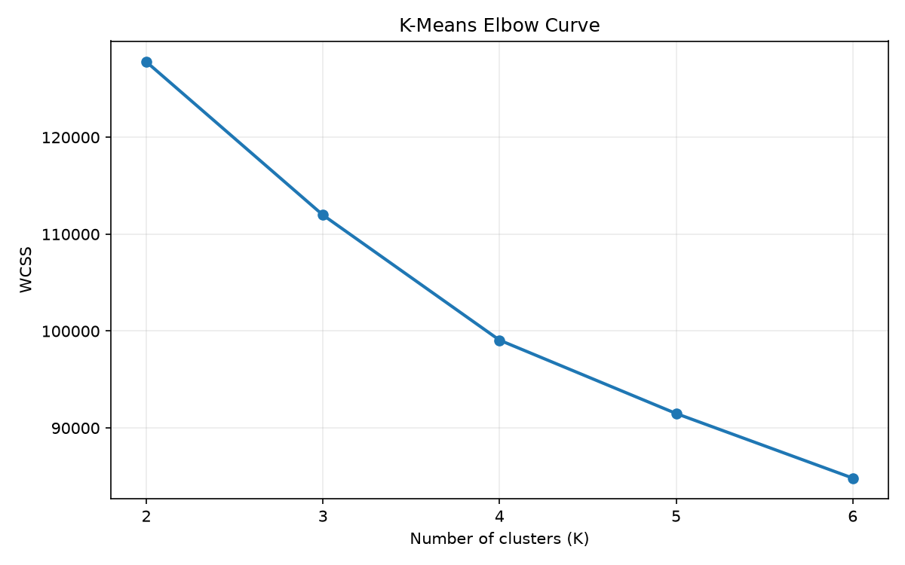
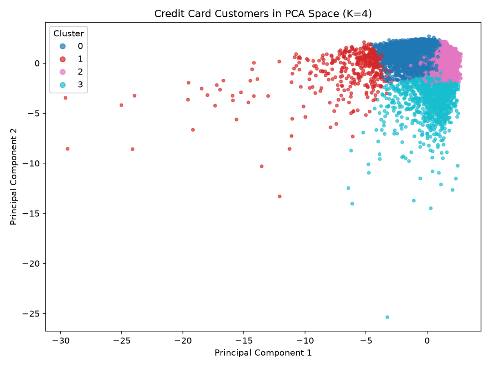

# Machine Learning Benchmarks: Classification, Regression, Clustering & PCA

[](https://www.python.org/downloads/)
[](https://pytorch.org/)
[](https://scikit-learn.org/)
[](https://opensource.org/licenses/MIT)
[](https://github.com/psf/black)

Comprehensive empirical study and benchmark implementations for classification, regression, clustering, and dimensionality reduction using standard UCI and Kaggle datasets.

---

## Table of Contents

- [Overview](#overview)
- [Project Architecture](#project-architecture)
- [Part 1: Multi-Class Classification (Steel Plates Faults)](#part-1-multi-class-classification-steel-plates-faults)
  - [Dataset](#dataset-steel-plates-faults)
  - [Models & Architectures](#models--architectures)
  - [Empirical Results](#classification-results)
  - [ROC Curve Analysis](#roc-curve-analysis)
  - [Overfitting & Model Complexity](#overfitting--model-complexity)
- [Part 2: Regularized & Non-Linear Regression (Superconductivity)](#part-2-regularized--non-linear-regression-superconductivity)
  - [Dataset](#dataset-superconductivity)
  - [Models Implemented](#models-implemented)
  - [Empirical Results](#regression-results)
  - [Bias-Variance & Overfitting Demonstration](#bias-variance--overfitting-demonstration)
  - [Hyperparameter Optimization via Cross-Validation](#hyperparameter-optimization-via-cross-validation)
- [Part 3: K-Means Clustering & PCA (Credit Card Customers)](#part-3-k-means-clustering--pca-credit-card-customers)
  - [Dataset](#dataset)
  - [Methods Implemented from Scratch](#methods-implemented-from-scratch)
  - [K-Means Results](#k-means-results)
  - [PCA Results](#pca-results)
- [Installation & Quickstart](#installation--quickstart)
- [Reproducibility](#reproducibility)
- [License](#license)

---

## Overview

This repository contains rigorous implementations, cross-validation studies, and detailed analytical reports for:
1. **Multi-class fault diagnosis** on the [UCI Steel Plates Faults Dataset](https://archive.ics.uci.edu/dataset/198/steel+plates+faults) comparing non-parametric, tree-based, margin-based, and deep learning classifiers.
2. **Critical temperature prediction** on the [UCI Superconductivity Dataset](https://archive.ics.uci.edu/dataset/464/superconductivty+data) comparing first-order optimization (Gradient Descent from scratch), non-linear polynomial mapping, and $L_1$/$L_2$ regularized estimators.
3. **Customer segmentation and dimensionality reduction** on the [Credit Card Dataset for Clustering](https://www.kaggle.com/datasets/arjunbhasin2013/ccdata), using K-Means and PCA implemented from scratch.

---

## Project Architecture

```
ml-benchmarks/
├── q1_classification.py        # Question 1: Classification pipelines & evaluation
├── q2_regression.py            # Question 2: Regression models, GD from scratch & CV
├── q3_clustering_pca.py         # Question 3: K-Means and PCA from scratch
├── ML_Assignment_Report.md     # Detailed formal submission report
├── requirements.txt            # Dependency specifications
├── LICENSE                     # MIT License
└── outputs/
    ├── q1/                     # Classification figures & visualizations
    │   ├── classifier_comparison.png
    │   ├── cm_KNN_*.png
    │   ├── cm_Decision_Tree_*.png
    │   ├── cm_SVM_*.png
    │   ├── cm_Deep_Convolutional_Neural_Network_*.png
    │   ├── roc_knn.png
    │   ├── roc_dt.png
    │   ├── roc_svm.png
    │   ├── roc_cnn.png
    │   ├── dt_depth_analysis.png
    │   ├── knn_cv_accuracy.png
    │   └── cnn_training_curve.png
    └── q2/                     # Regression figures & visualizations
        ├── actual_vs_predicted.png
        ├── gd_convergence.png
        ├── poly_overfitting.png
        ├── ridge_cv_alpha.png
        ├── lasso_cv_alpha.png
        ├── residuals.png
        └── regression_comparison.png
    └── q3/                     # Clustering and PCA figures & data
        ├── kmeans_elbow_curve.png
        ├── pca_cumulative_explained_variance.png
        ├── pca_first_two_components.png
        ├── pca_variance_summary.csv
        ├── pca_eigenvectors.csv
        └── pca_2_and_3_component_reductions.csv
```

---

## Part 1: Multi-Class Classification (Steel Plates Faults)

### Dataset: Steel Plates Faults
- **Source:** [UCI Machine Learning Repository #198](https://archive.ics.uci.edu/dataset/198/steel+plates+faults)
- **Instances:** 1,941 samples | **Features:** 27 numerical descriptors
- **Classes:** 7 fault types (`Pastry`, `Z_Scratch`, `K_Scratch`, `Stains`, `Dirtiness`, `Bumps`, `Other_Faults`)
- **Protocol:** Stratified 80/20 train-test split (1,552 train / 389 test). Feature standardization fit strictly on train split.

### Models & Architectures
1. **K-Nearest Neighbors (KNN):** Hyperparameter selection via 5-fold Stratified Cross-Validation ($k \in \{3, 5, 7, 9, 11, 15\}$). Optimal $k = 5$ ($\text{CV Acc} = 0.7319 \pm 0.0160$).
2. **Decision Tree Classifier:** Pruning and depth constraint analysis across maximum depths $1 \le d \le 20$. Optimal test generalization achieved at depth $d = 12$.
3. **Support Vector Classifier (RBF Kernel):** Non-linear mapping using radial basis function with 3-fold grid optimization ($C = 10, \gamma = \text{'scale'}$).
4. **Deep Convolutional Neural Network (PyTorch Bonus):** A 1D CNN over the 27 standardized descriptors, with two convolutional blocks, Batch Normalization, Max Pooling, Dropout, adaptive average pooling, and an output layer for seven fault classes.

### Classification Results

| Model | Accuracy | Precision (Weighted) | Recall (Weighted) | F1-Score (Weighted) | ROC-AUC (OvR Weighted) |
|---|:---:|:---:|:---:|:---:|:---:|
| **KNN ($k=5$, 5-fold CV)** | 0.7121 | 0.7143 | 0.7121 | 0.7091 | 0.8889 |
| **Decision Tree ($d=12$)** | 0.7558 | 0.7628 | 0.7558 | 0.7569 | 0.8386 |
| **SVM (RBF, $C=10$)** | 0.7609 | 0.7639 | 0.7609 | 0.7617 | 0.9247 |
| Deep Convolutional Neural Network (Bonus) | 0.6581 | 0.6084 | 0.6581 | 0.6255 | 0.8787 |

<p align="center">
  
</p>

### ROC Curve Analysis
- **SVM with RBF Kernel** achieved the highest weighted **ROC-AUC of 0.9247**, effectively projecting the 27 geometric properties into a high-dimensional feature space where non-linear fault boundaries become linearly separable.
- **CNN** reached a weighted ROC-AUC of **0.8787**. It fulfils the bonus convolutional-model requirement, but its local-filter bias is less suited to the arbitrary ordering of tabular descriptors.
- **Decision Trees (0.8386)** showed the weakest ranking ability due to axis-parallel orthogonal decision boundaries that struggle with correlated feature manifolds.

<p align="center">
  
  
</p>

### Overfitting & Model Complexity
- **Decision Tree Depth Exploration:** As tree depth grows from 1 to 20, training accuracy monotonically increases toward 100%. However, validation performance peaks at $d=12$ and degrades beyond $d > 16$, demonstrating classic variance explosion.
- **CNN Regularization:** The convolutional architecture uses Batch Normalization, Dropout ($p=0.2$ to $0.3$), and weight decay regularization ($10^{-4}$).

---

## Part 2: Regularized & Non-Linear Regression (Superconductivity)

### Dataset: Superconductivity
- **Source:** [UCI Machine Learning Repository #464](https://archive.ics.uci.edu/dataset/464/superconductivty+data)
- **Instances:** 21,263 samples | **Features:** 81 elemental and chemical property statistics
- **Target:** Critical Superconducting Temperature $T_c \in [0.0, 185.0]\text{ K}$
- **Protocol:** 80/20 train-test split (17,010 train / 4,253 test) with feature-wise zero-mean unit-variance scaling.

### Models Implemented
1. **Batch Gradient Descent (from scratch):** Vectorized closed-loop parameter updating without high-level library estimators:
   $$\theta^{(t+1)} = \theta^{(t)} - \frac{2\alpha}{n} X_b^T \left(X_b \theta^{(t)} - y\right)$$
   Configured with $\alpha = 0.01$ and $1,000$ iterations, verified through monotonic cost decrease.
2. **Polynomial Regression:** Degree progression ($d \in \{1, 2, 3, 4, 5\}$) evaluated on PCA-projected features (10 principal components capturing $>85\%$ variance).
3. **Ridge Regression ($L_2$ Penalty):** Minimizing $\|y - X\theta\|_2^2 + \alpha\|\theta\|_2^2$ over $\alpha \in [10^{-3}, 10^3]$ using 5-fold cross-validation.
4. **Lasso Regression ($L_1$ Penalty):** Minimizing $\|y - X\theta\|_2^2 + \alpha\|\theta\|_1$ with automatic coordinate descent feature selection.

### Regression Results

| Model | Train MSE | Train RMSE | Train $R^2$ | Test MSE | Test RMSE | Test $R^2$ |
|---|:---:|:---:|:---:|:---:|:---:|:---:|
| **Linear GD (from scratch)** | 348.1037 | 18.6575 | 0.7047 | 333.5128 | 18.2623 | 0.7103 |
| **Polynomial Regression ($d=3$)** | **256.8458** | **16.0264** | **0.7821** | **254.6474** | **15.9577** | **0.7788** |
| **Ridge Regression ($\alpha=0.1$)** | 310.2255 | 17.6132 | 0.7368 | 302.1473 | 17.3824 | 0.7375 |
| **Lasso Regression ($\alpha=0.01$)** | 313.5951 | 17.7086 | 0.7340 | 304.8200 | 17.4591 | 0.7352 |

<p align="center">
  
</p>

### Bias-Variance & Overfitting Demonstration

The polynomial degree progression illustrates bias-variance tradeoff across the continuum:

| Degree | Train MSE | Test MSE | Train $R^2$ | Test $R^2$ | Regime |
|:---:|:---:|:---:|:---:|:---:|:---|
| **1** | 508.05 | 480.50 | 0.5690 | 0.5826 | **High Bias (Underfitting)** |
| **2** | 333.00 | 314.38 | 0.7175 | 0.7269 | Balanced reduction in error |
| **3** | **256.85** | **254.65** | **0.7821** | **0.7788** | **Optimal Generalization Peak** |
| **4** | 213.92 | 411.63 | 0.8185 | 0.6424 | Variance increases; test MSE nearly doubles |
| **5** | 149.48 | 39,129.01 | 0.8732 | -32.9933 | **Catastrophic Overfitting (Exploding Variance)** |

<p align="center">
  
</p>

### Hyperparameter Optimization via Cross-Validation
- **Ridge Regression:** 5-fold CV identified $\alpha^* = 0.1$ ($\text{CV MSE} = 313.3097 \pm 8.9554$).
- **Lasso Regression:** 5-fold CV identified $\alpha^* = 0.01$ ($\text{CV MSE} = 316.4013 \pm 10.1862$), retaining **73 non-zero coefficients** out of 81 features, effectively weeding out uninformative descriptors.

<p align="center">
  
  
</p>

---

## Part 3: K-Means Clustering & PCA (Credit Card Customers)

### Dataset

- **Source:** [Kaggle Credit Card Dataset for Clustering](https://www.kaggle.com/datasets/arjunbhasin2013/ccdata)
- **Instances:** 8,950 credit-card customers
- **Features:** 17 numeric customer-behaviour features; `CUST_ID` is excluded as an identifier.
- **Preprocessing:** Missing numeric values are median-imputed, then all features are standardized.
- **Local setup:** Download `CC GENERAL.csv` from Kaggle and place it at `archive/CC GENERAL.csv`. The raw dataset is intentionally not committed to this repository.

### Methods Implemented from Scratch

1. **K-Means:** NumPy-based centroid initialization, assignment/update iterations, empty-cluster handling, and WCSS calculation. Each K uses ten initializations, retaining the lowest-WCSS result.
2. **PCA:** Covariance-matrix computation and eigendecomposition with NumPy. The saved outputs include all eigenvalues, eigenvectors, explained-variance ratios, and 2-PC/3-PC reduced data.

### K-Means Results

| K | WCSS |
|---:|---:|
| 2 | 127,784.30 |
| 3 | 111,973.61 |
| 4 | 99,061.94 |
| 5 | 91,491.11 |
| 6 | 84,826.40 |

The elbow is at **K=4**, which is used for the PCA-space cluster visualization.

<p align="center">
  
  
</p>

### PCA Results

- First 2 principal components explain **47.61%** of the variance.
- First 3 principal components explain **56.42%** of the variance.
- `pca_cumulative_explained_variance.png` visualizes cumulative variance across all components.

---

## Installation & Quickstart

### Prerequisites
- Python 3.10 or higher
- Git

### Setup
```bash
# Clone the repository
git clone https://github.com/rudrakshkapil09x/machine-learning-benchmarks.git
cd machine-learning-benchmarks

# Install dependencies
pip install -r requirements.txt
```

---

## Reproducibility

Execute the respective pipelines to reproduce all empirical metrics and regenerate visual plots:

```bash
# Run Question 1: Classification benchmark
python q1_classification.py

# Run Question 2: Regression benchmark
python q2_regression.py

# Run Question 3: K-Means clustering and PCA
python q3_clustering_pca.py
```

All figures and tabular outputs will be populated in `outputs/q1/`, `outputs/q2/`, and `outputs/q3/` respectively.

---

## License

This project is licensed under the MIT License - see the [LICENSE](LICENSE) file for details.
